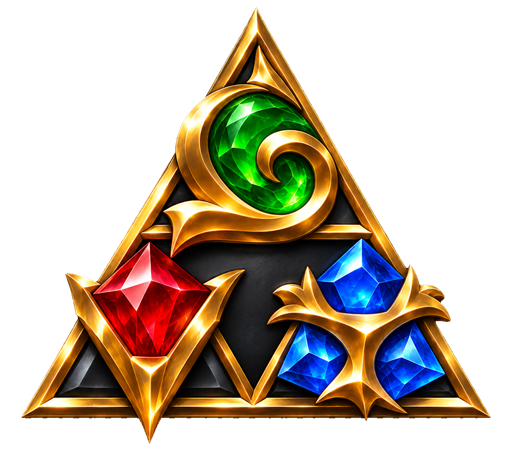

<p align="center">
  
</p>

<p align="center">
  
</p>

<p align="center">
  <b>Ocarina of Time for Nintendo Switch 2, running natively on your PC.</b><br>
  <sub>No emulator: the game's code is recompiled into a real Windows program and its graphics redrawn on Vulkan.</sub>
</p>

<p align="center">
  <a href="https://triforceproject.com"></a>
  
  
  
  
</p>

<p align="center">
  <a href="#the-three-pieces">About</a> &nbsp;◆&nbsp;
  <a href="#installing-triforce">Install</a> &nbsp;◆&nbsp;
  <a href="#every-time-you-play">Playing</a> &nbsp;◆&nbsp;
  <a href="#before-you-play">Settings</a> &nbsp;◆&nbsp;
  <a href="#controls">Controls</a> &nbsp;◆&nbsp;
  <a href="#convert-saves">Saves</a> &nbsp;◆&nbsp;
  <a href="#mods">Mods</a> &nbsp;◆&nbsp;
  <a href="#under-the-surface">How it works</a> &nbsp;◆&nbsp;
  <a href="#the-sages">Credits</a>
</p>

<p align="center"></p>

##  The three pieces

**Triforce** is a native PC version of the Switch 2 *Ocarina of Time*. Every piece has one job: to make Hyrule on your
PC look and play exactly the way it does on the console.

| | Piece | What it does |
|:-:|---|---|
|  | **Power** · the recompiler | Turns the game's own ARM64 code into a Windows program ahead of time. No emulation at runtime, no CPU guessing. |
|  | **Wisdom** · the system | Plays the part of the console's operating system: files, saves, audio, controllers, threads and timing. |
|  | **Courage** · the renderer | Rebuilds the Switch 2 graphics on Vulkan, with the game's own lighting, fog, water and foliage. |

What makes Triforce's Hyrule look right:

-  **Living forest:** trees with full canopies, ferns, grass,
  drifting leaves and fireflies, all drawn by the game's own GPU culling.
-  **True light:** ambient light probes keep Link, signs and
  plants lit in the shade; the pond's water and the game's own fog are as the console shows them, with no tuned
  workarounds on top.
-  **Steady play:** no freeze after loading a save, no exposure
  flicker, and GPU data that survives memory pools being rebuilt.
-  **Triforce Setup:** one small download that installs, builds,
  updates and launches the game, with your settings, controls and saves handled before the game even starts.

> [!IMPORTANT]
> **Bring your own game.** Triforce contains no game data, no keys and no ready-made executable, and it won't tell you
> how to get them. Everything is built **on your PC, from your own copy**, and everything it makes (the program, the
> generated code, shader caches and saves) stays yours. Don't share those files.

<p align="center"></p>

##  Installing Triforce

*Every hero starts in the forest.* You download one small program, **Triforce Setup**, and it does the rest: the game
itself is assembled on your PC, from your copy, in one guided build.

### Before you start

| You need | Details |
|---|---|
|  Windows | 10 or 11, 64-bit. Nothing else to install: Setup runs on what Windows already has |
|  Graphics card | Vulkan 1.3 with mesh shaders, on an up-to-date driver (tested on NVIDIA) |
|  Memory | 16 GB of RAM or more (the game uses about 10 GB) |
|  Disk space | About 2 GB for Setup and its tools, and about 60 GB free while building |
|  Your game | Program `0400486024DEC000`, update v131072, build `e0f3ccfa`, as a `.nup` or as `romfs` + `exefs` folders. Other versions are refused. |

### Four steps to Hyrule

**1 · Download.** Get **`TriforceSetup.exe`** from the [newest release](https://triforceproject.com)
and run it.

**2 · Install.** Choose where Triforce goes (your own user folder by default, so no administrator prompt) and whether
you want it on the desktop and in the Start menu. Setup then fetches the Triforce tools (about 250 MB, once).

**3 · Forge your game.** Point Setup at your game, either the `.nup` or the `romfs` and `exefs` folders; it checks the
version first. Pick a language and a folder for the game, then press **Build**. The first build takes around
**40 minutes**, and your PC stays usable the whole time.

**4 · Play.** Press **Play**. Settings and controls are in the game's own **Options** screen.

From then on, the **Triforce** shortcut on your desktop and in the Start menu opens Setup first: that's where updates and saves live.

### Uninstalling

Remove **Triforce** from Windows' *Settings → Apps*. That takes Setup, its tools, its `save-backups` folder and the build's
work folder (`%LOCALAPPDATA%\Triforce\build`) away; your game folder and its saves stay until you delete them yourself.

<p align="center"></p>

##  Every time you play

Opening Triforce shows the **Welcome back** screen first: your game, your saves and the newest Triforce side by side.

- **A new version is out:** choose **Update & merge** to bring it into your game, or **Not now** to keep playing what you
  have; you'll be asked again next time. Updating downloads the new release and builds your game folder again from the
  game files it keeps. Only what changed is compiled again, so it usually takes a few minutes. **Your saves and
  settings stay.** Setup keeps itself up to date the same way.
- **You're up to date:** press **Continue**.
- **No internet, or GitHub is down:** Setup says so, and you play what you have.

Then come your settings, and **Start game**.

<p align="center"></p>

##  Settings

*Choose your path.* Settings live in the game's own **Options** screen (title screen or pause menu): the tabs Display,
Graphics, Audio, Controls and System sit beside the game's own list, and **L** / **R** switch between them. A few
apply at the next start; the game asks. They're saved in `triforce_options.ini` beside the game.

| Setting | Options |
|---|---|
| Quality preset | Custom, Minimum (4 GB), Low (6 GB), Balanced (8 GB), High (12 GB), Ultra (16 GB+): one choice that sets resolution, upscaling, frame generation and VRAM limits for your card |
| Fullscreen | Off, On |
| Frame generation | Off, 2x up to 8x |
| Frame pacing | Off, On |
| Resolution | Auto (the game's dynamic resolution), 100%, 75%, 67%, 50% |
| Upscaling | Off, Catmull-Rom, Lanczos, AMD FSR 1 |
| Sharpness | 0–100% |
| Texture filtering | Game's, 2x, 4x, 8x, 16x anisotropic |
| Game speed | Real time (keeps normal pace), Per frame (slows down below 60 fps) |
| Handheld profile | Off, On |
| Ultrawide | 16:9, Monitor's shape |
| FPS counter | Off, On |
| Controller in background | Off, On: the pad keeps playing while another window has focus |
| Text speed | Normal, 2x, 4x, Instant |

In game, **F10** or **Alt+Enter** switches between a window and fullscreen. **F1** opens the same options from anywhere.

<p align="center"></p>

##  Controls

Play with a controller, or with keyboard and mouse. The **Controls** tab of the game's Options sets what presses
each Switch button: one controller input and up to two keys.

Moving (<kbd>W</kbd> <kbd>A</kbd> <kbd>S</kbd> <kbd>D</kbd>) and the camera (arrow keys, or <kbd>I</kbd> <kbd>J</kbd>
<kbd>K</kbd> <kbd>L</kbd>) are fixed.

<p align="center"></p>

##  Convert saves

Coming from an emulator? Your journey comes with you. **Convert saves** on the Welcome back screen moves saves of this
game between Triforce and an emulator, in either direction:

- **Into Triforce:** Setup looks for your saves by itself (Eden, yuzu, suyu, Sudachi, Citron, torzu and Ryujinx, and
  portable copies started from a desktop or Start menu shortcut), or you choose the folder.
- **Out of Triforce:** your Triforce saves go back to an emulator the same way.

Every slot comes across as it is. Whatever gets replaced is backed up first, in the `save-backups` folder beside Setup.
Close the game and the emulator before converting.

<p align="center"></p>

##  If something goes wrong

| What happens | What to try |
|---|---|
| Setup says the build isn't supported | Check you chose the right game, with its update installed |
| Setup says GitHub could not be reached | Check your connection; you can still play what you have |
| The game opens and closes straight away | Update your graphics driver |
| A short hitch the first time something appears | Expected for now: shaders are being prepared, and the same spot is smooth next time |
| The wrong language | Edit the code in `language.txt` beside the game; the file lists them all |

Still stuck? [Open an issue](https://github.com/ruckus7382sfgsgdf/CBeta0.2/issues) with where you were in the game, your
graphics card, a screenshot or clip, and `triforce_log.txt` from the game folder. **Never attach game files.**

<p align="center"></p>

##  Mods

Make a `mods` folder beside `Triforce.exe` and drop mods in with the usual layout: `mods/<name>/romfs/...` replaces or
adds game files. Deeper layouts such as `mods/contents/<title id>/<name>/romfs` work too.

- Start a folder's name with `-` or `_` to switch that mod off.
- When two mods carry the same file, the folder name that sorts last wins: number them `01-…`, `02-…` to set the order.
- Only **RomFS** mods load. Code patches (`.pchtxt`, `.ips`) don't apply, because the game's code is compiled ahead of
  time.
- `triforce_log.txt` lists every mod that loaded and the files it supplied.

<p align="center"></p>

##  Under the surface

*Zora wisdom: what happens beneath the water.*

1. **Translate:** `nx2/lift.py` turns the game's ARM64 machine code into C.
2. **Compile:** `nx2/build.py` builds that C together with `host/`, which stands in for the console's operating system.
3. **Replay:** `host/nvn_native.c` captures every NVN2 graphics call the game makes, and `gpu/vk/` replays it on Vulkan.
4. **Shaders:** Switch 2 Ampere shaders are lowered to Maxwell (`lower_to_maxwell.h`), then translated to SPIR-V.

The [development guide](docs/development.md) and [design notes](docs/design.md) go deeper.

<details>
<summary><b>Building from source</b></summary>

<br>

From a clone of this repository, the game is built with:

```powershell
python -I nx2/make_game.py --nup "C:\path\your-game.nup" --out "C:\Games\Triforce" --language en-US
```

Use `--romfs` and `--exefs` in place of `--nup` for unpacked folders, `--update <game folder>` to build a folder again
from the game files it keeps, or `--check` to only verify the game's version. You'll need Python 3 with `lz4`, `numpy`,
`capstone`, `unicorn` (2.1) and `zstandard`, plus the compiler and libraries described in the
[development guide](docs/development.md).

Triforce Setup lives in `setup/`: `setup\build.ps1 -Version vX.Y.Z` makes `TriforceSetup.exe`, and
`setup\pack_tools.ps1 -Tag vX.Y.Z` makes `Triforce-Tools.zip`. A release carries both files under the same tag.

</details>

<p align="center"></p>

##  Join the quest

The simplest help of all: **run Triforce on a graphics card nobody has tried yet, or play further than anyone has, and
report back.**

Want to do more? Fork it, fix what you find, and send the change back. Keep game files, keys and anything generated
from your game out of your fork. [CONTRIBUTING.md](CONTRIBUTING.md) explains the setup, the test commands, the code
style and what a good pull request looks like.

<p align="center"></p>

##  The Sages

*Seven Sages sealed the Triforce. These ones helped forge it.*

> **Triforce is built off Hookshot**, NotRexed's native recompilation of the Switch 2 *Ocarina of Time*.

- **Evil:** Triforce's creator and lead. Brought Kokiri Forest back to life with
  the GPU culling fixes for trees, ferns, grass, falling leaves, fireflies and the tree canopies; fixed the ambient
  light probes, the pond's water, the game's own fog, the freeze after loading a save and the exposure flicker; made the
  rendering diagnostics tools and Triforce Setup.
- **NotRexed:** Hookshot, the recompiler this build started from, as well as BlueShell (Mario Kart World),
  Skybound (Tears of the Kingdom) and the a64-kit tools.
- **Eden** and **Eglantine:** the shader recompiler and the Switch 2 shader work.
- **suyu:** the graphics decoders and the AArch64 translator.
- **seedds (nxnative):** how task and mesh shaders really behave.
- **zortos293 (Lichii):** Ampere shader lowering, and the compare-exchange retry fix.
- **mstorsjo (llvm-mingw):** the Windows compiler that comes with the build, so no Visual Studio is needed.
- **kinnay (zbic)**, **Opus** and **SDL:** decompression, sound and controller input.
- **sostenesfreitas (ocarina-recomp):** an early README layout, and notes that confirmed the mesh stage's control
  section.
- **MythosOfs (Orchid):** the original fog and exposure workaround for Ocarina of Time.
- **Carlos Lopez (clshortfuse) and [RenoDX](https://github.com/clshortfuse/renodx):** the HDR tone mapping, eye
  adaptation and colour grading of the optional RenoDX HDR build, from RenoDX's mod for Ocarina of Time.
- **Mesa (NAK):** the map of Ampere's instruction encoding.
- **Everyone who sent fixes:** SkippySteve (a great many of them), klimovich008, d3zessete, chrispository, vzeol,
  monsterlag, leonidasmark, Segmentree, Zorkats, ShyVortex, hiKareeem, gab9281, i900gaming and more.

<p align="center"></p>

##  License

Triforce is open source under the **GNU General Public License, version 3 or any later version**. You're free to use
it, study it, change it and share it, as long as anything you share stays under the same license, with its source
available. The full terms are in [LICENSE](LICENSE).

Parts of Triforce come from other GPL projects (NotRexed's recompiler, Eden, suyu and Orchid) and remain under the
GPL. Bundled components with their own GPL-compatible licenses (Sirit, Vulkan Memory Allocator, SDL, Opus, stb, zbic
and the a64-kit tools) keep their notices in their own folders. Triforce Setup's tools package also carries Python and
llvm-mingw, under their own licenses.

The optional RenoDX HDR support is worked from RenoDX, which is under the MIT license: its notice is in
[third_party/renodx/LICENSE.md](third_party/renodx/LICENSE.md). RenoDX's own shaders are never part of Triforce: a
build that asks for them downloads and compiles them on the builder's PC.

<sub>Triforce is a fan-made project with no connection to Nintendo, and Nintendo hasn't endorsed it. The Legend of
Zelda and Ocarina of Time are Nintendo's trademarks.</sub>
